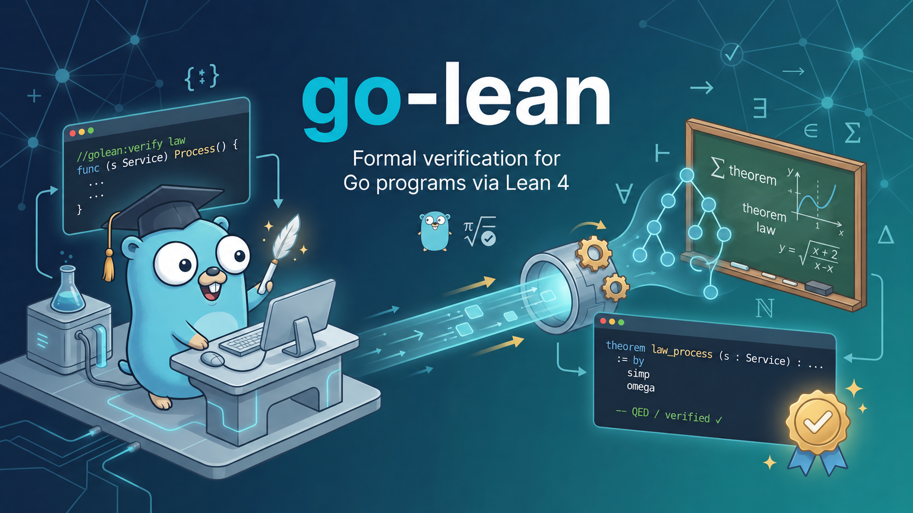

# go-lean



go-lean translates selected Go functions and methods into Lean so you can prove properties of their behavior. Mark an operation with a `//golean:verify` law, generate its Lean model, then prove the law in a handwritten Lean file. The translator follows reachable helpers and checks them against its supported Go subset.

> **Verification limitations**
>
> Lean checks the laws against the generated model. Applying a theorem to a Go execution depends on the translation preserving Go semantics, the law's preconditions holding, and modeled dependencies meeting their contracts.

## Featured example: verified toy compiler

Compile a typed prefix expression from source bytes to stack bytecode. Lean checks tokenization, parsing, type checking, emission, and the VM's instruction step individually. The end-to-end proof shows that compilation returns the specified diagnostic or produces code that halts with the expression's value.

```sh
go run ./examples/provable/bytecode_vm/compiler/cmd/toy-compiler "and eq add 255 1 0 not false"
# Bool: true
```

[Read the compiler walkthrough](docs/toy-compiler.md).

## Use go-lean in a Go module

Use Go 1.26.0 or later and install Elan to provide `lean` and `lake` on PATH.

From your Go module root, add go-lean as a project tool and set up Lean:

```sh
go get -tool github.com/frederik-jatzkowski/go-lean/cmd/go-lean@latest
go tool go-lean setup
go tool go-lean doctor
```

Commit the resulting `go.mod` and `go.sum` so contributors and CI use the same version through `go tool`. To choose a specific go-lean revision, replace `@latest` with a tag or commit. After adding laws and proofs, run `go tool go-lean verify` for the whole workspace or `go tool go-lean verify ./pkg` for one package.

The proof suite is tested with Lean 4.35.0 and 4.36.0. Setup creates a missing `lean-toolchain` with Lean 4.36.0 and keeps an existing one. To use Lean 4.35.0, put `leanprover/lean4:v4.35.0` in your project's `lean-toolchain` and run verification from the module root.

## Documentation

- [Writing and checking laws](docs/verification.md) covers directives, generated files, and dependency contracts.
- [Supported Go](docs/supported-go.md) describes accepted Go patterns and their Lean representations.
- [Roadmap](docs/roadmap.md) describes directions for expanding the translator and its proof coverage.
- [Expression parser](docs/expression-parser.md) proves that a tokenizer and parser together recognize a byte grammar.
- [Order service](docs/order-service.md) proves domain transitions over command histories and checks when service methods call a repository.
- [Ten-pin bowling](docs/bowling.md) proves roll acceptance and final scoring over arbitrary roll histories.

## More examples

- **Bounded receiver updates.** Prove stock accounting over a processed prefix. [Batch fulfillment](examples/provable/batch_fulfillment/batch_fulfillment_proofs.lean)
- **Discharging a dependency contract.** Prove that a translated implementation supplies the read-your-writes law a caller needs. [Key-value store](examples/provable/kv_store_contract_impl/kv_store_contract_impl_proofs.lean)
- **State-machine histories.** Explore proofs over sequences of actions. [Grid game](examples/provable/grid_game) and [Nine Men’s Morris](examples/provable/nine_mens_morris)

For commands that run from a checkout of this repository, see [Contributing](CONTRIBUTING.md).

## License

Copyright © 2026 Frederik Jatzkowski. go-lean is licensed under the [GNU General Public License, version 3](LICENSE).
